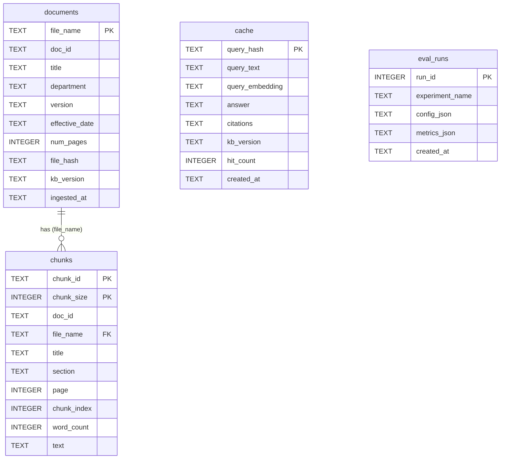
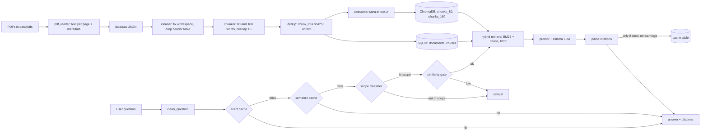

# 04. Database Design and Data Flow

Two stores with two jobs:

| Store | File/folder | Holds | Why |
|-------|-------------|-------|-----|
| **SQLite** | `data/db/rag.sqlite` | documents, chunks (text + metadata), cache, evaluation runs | structured data, easy to query |
| **ChromaDB** | `data/db/chroma/` | one vector per chunk in two collections: `chunks_80`, `chunks_160` | similarity search (cosine) |

Current contents of the submitted database: **10 documents, 72 chunk rows (50 at size 80, 22 at size 160), 2 cache rows, 0 `eval_runs` rows**.

## 1. Entity-relationship diagram

`cache` and `eval_runs` are standalone: they are not linked by foreign keys. `chunks` and Chroma entries share the same `chunk_id`.

## 2. Tables

### documents
One row per PDF. `file_name` is the primary key. `file_hash` (SHA-256 of the file bytes) detects changed PDFs. `kb_version` records which knowledge-base version the row belongs to.

### chunks
Primary key is **(chunk_id, chunk_size)**. `chunk_id` is the SHA-256 of the normalised chunk text, so identical text always gets the same ID. The same text can exist at both sizes, which is why `chunk_size` is part of the key. Foreign key `file_name` references `documents` (`PRAGMA foreign_keys = ON`).

### cache
`query_hash = sha256(kb_version + "|" + normalised question)`. `query_embedding` is a JSON list used by the semantic cache. `citations` is JSON. `hit_count` counts reuse. Only answered, cited, warning-free results are stored.

### eval_runs
Experiment name, config JSON, metrics JSON, timestamp. `save_eval_run()` replaces an older row with the same experiment name. It is empty in the submitted database because the experiment results were written to `reports/*.csv`.

## 3. ChromaDB collections

| Collection | Chunk size | Entries | Metadata stored |
|------------|-----------|---------|-----------------|
| `chunks_80` | 80 words | 50 | chunk_id, doc_id, file_name, title, section, page, chunk_index, chunk_size, word_count |
| `chunks_160` | 160 words | 22 | same |

Vectors have 384 dimensions, are normalised, and use `hnsw:space = cosine`. The Chroma ID is the `chunk_id`.

## 4. Idempotent ingestion (the P0 rule)

`sync_chunks()` compares IDs **wanted** with IDs **stored**:

- wanted, not stored: insert (SQLite `INSERT OR IGNORE`) and embed + add to Chroma
- stored, not wanted: delete (old text from a changed PDF)
- in both: do nothing, and no embedding is computed

`sync_documents()` compares each PDF's `file_hash` with the saved one and reports `new / updated / unchanged`. Result: a second `python scripts/run_ingest.py` reports 0 new documents and 0 new chunks.

De-duplication: the "Confidentiality Notice" text appears in all PDFs; because the ID is a hash of its text, only one copy is kept.

## 5. Cache safety in the data model

- `kb_version` is inside the key, so bumping it in `config.yaml` makes old entries unreachable. `ExactCache.clear_old_versions()` deletes them.
- The semantic cache only reads rows where `kb_version` equals the current version.

## 6. Data flow

Note: after the PDFs are processed, `data/processed/chunks_80.json` and `chunks_160.json` hold the unique chunks, which `run_ingest.py` syncs into both stores.
